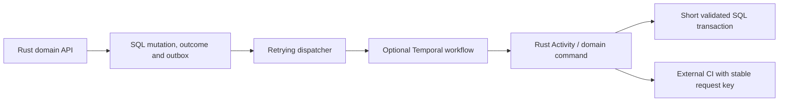

# Durability, ACID boundaries and workflow engines

**Checked:** 16 October 2026. **Status:** research and proposed requirements; no implementation, certification, benchmark or failure-test results. The user confirmed that “BDOS” meant **DBOS Durable Execution**. This supplements the [technical plan](technical-plan.md) and [Rust scaling plan](rust-backend-scaling.md).

## 1. Recommendation

Keep **PostgreSQL transactions as the authority for repository mutations** and retain a transactional outbox with fenced Rust workers for the first self-hostable version. Durability and isolation are release requirements even when no workflow engine is installed.

Evaluate **PostgreSQL workers, Temporal and Restate** using the same thin CI-to-landing fixture in roadmap F2, before implementing an elaborate homegrown workflow framework. Temporal remains the prior leading candidate, but evidence must allow another arm to win. Real integration is qualified in M4, rather than deferring the first experiment until the product is finished. See the [roadmap](implementation-roadmap.md) and [three-arm test plan](workflow-evaluation-plan.md).

A workflow engine becomes worthwhile when durable timers, human/CI waits, cancellation, operator recovery and multi-step retries are substantial product requirements. Do not wait for high traffic to justify the experiment: workflow complexity and recovery burden are sufficient reasons. Conversely, high request volume alone does not establish a need for an engine.

**Do not select DBOS as the Rust transactional foundation today.** An official Rust SDK exists, but its current published material describes missing transactional steps. It can still orchestrate idempotent domain commands; it does not presently remove our application transaction/checkpoint gap. Revisit a pinned release when that feature and multi-replica recovery are demonstrated. [Official Rust repository](https://github.com/dbos-inc/dbos-transact-rust), [transactional-step issue](https://github.com/dbos-inc/dbos-transact-rust/issues/48).

This is an architecture recommendation and experiment plan, not a completed adoption decision. No external service or dependency was installed.

## 2. What each option provides

| Option | Useful role | Additional burden / limit | Decision |
| --- | --- | --- | --- |
| PostgreSQL transactions + outbox + bounded workers | Atomic domain state and durable enqueue; short retryable jobs | We must implement and test leases, fencing, backoff, job states, visibility and reconciliation | Default for core mutations and small jobs; stop short of building a general workflow engine. |
| Temporal + Rust workers | Durable lifecycle coordination, waits, retries and operator-visible execution history | Separate service/persistence/operations; replay/versioning obligations; external Activity effects still need idempotency | Required F2 comparison arm; optional adoption after M4 failure/versioning/operations evidence. |
| Restate + Rust workers | Journaled lifecycle execution and durable waits/state through its Rust SDK | Separate service/journal/deployment operations; external effects still need domain idempotency; current server is BSL 1.1, SDK MIT | Required F2 comparison arm; licensing/distribution and M4 recovery evidence gate adoption. |
| DBOS Rust | Embedded, Postgres-backed durable workflows | Early SDK; current missing transactional steps; recovery/version features need exact-release validation | Keep on watch list and bounded evaluation; not the core transaction mechanism. |

Temporal announced its Rust SDK as generally available on September 4, 2026; older preview-only descriptions are stale. [Temporal GA announcement](https://temporal.io/changelog/rust-sdk-generally-available). Its self-hosted service supports PostgreSQL persistence; Cassandra is not a mandatory dependency. Service and application records are nevertheless separate commit domains. [Temporal configuration reference](https://docs.temporal.io/references/service-configuration). Review release-specific API stability and licenses in the [Temporal memo](research/temporal-durability.md).

DBOS's official Rust release page currently marks 0.5.0 as a pre-release. Generic DBOS documentation for Go/Python/TypeScript/Java must not be treated as Rust feature parity. [Rust releases](https://github.com/dbos-inc/dbos-transact-rust/releases). DBOS's library and Conductor also differ: self-hosted Conductor has a proprietary license and requires a production license key. An OSS-only installation must not silently depend on it. [Conductor self-hosting](https://docs.dbos.dev/conductor/self-hosting/hosting-conductor). These are dated findings to recheck at implementation.

The user subsequently requested Restate testing alongside Temporal. Restate's [server license](https://github.com/restatedev/restate/blob/main/LICENSE) is Business Source License 1.1, with an Additional Use Grant and release-specific change terms; its [Rust SDK](https://github.com/restatedev/sdk-rust/blob/main/LICENSE) is MIT. The server's current license is not an open-source license. Include it in experiments while explicitly reviewing the exact version and intended distribution/hosting before making it mandatory. The [evaluation plan](workflow-evaluation-plan.md#2-restate-facts-and-licensing-gate) records this distinction without assuming all production use is prohibited.

## 3. Define the ACID contract precisely

The proposed ACID unit is **one authoritative repository/domain mutation**, not the hours-long process of review, CI and landing combined. A workflow is a series of transactions and external effects; compensation is not SQL rollback. Cancellation must not automatically undo a landed ref.

| Property | Required Open Scion behavior |
| --- | --- |
| Atomicity | Publication commits changeset metadata/edges/membership/pins, idempotent outcome and outbox together. Landing commits ref movement, landing result, audit and outbox together. No half-published domain transition. |
| Consistency | Enforce same-repo parent/object membership, canonical content identity, unique request outcomes, valid state transitions, exact candidate/check binding and protected-ref policy. Database constraints plus domain validation preserve these invariants. |
| Isolation | Concurrent operations cannot both succeed from one expected ref generation or authorize a stale candidate. Predicate-based approval/policy rules need a consistent transaction protocol, not merely a ref CAS. |
| Durability | A success response follows the configured durable object and SQL commits. Recovery retains required bytes and outcomes within a stated failure model, including the chosen failover policy. |

For the first implementation, use **`SERIALIZABLE` for correctness-critical metadata mutations**: changeset publication, protected ref/landing transitions, approval/check/policy changes participating in those invariants. Keep transactions short, use uniqueness/FKs and explicit ref generations, and implement bounded whole-transaction retries. All writers participating in an invariant must follow the same protocol. Independent disposable/index operations can use a separately justified isolation level.

This tightens the earlier plan's more general “row locks/CAS may suffice” guidance. `READ COMMITTED` remains possible for a specifically proven keyed invariant, but lowering isolation is an explicit reviewed optimization. PostgreSQL describes serialization anomalies under weaker isolation and requires retry handling for Serializable transactions. [PostgreSQL isolation](https://www.postgresql.org/docs/current/transaction-iso.html).

`SERIALIZABLE` does not make validation performed outside the transaction authoritative. Construct expensive immutable candidates outside it, then re-read/revalidate current policy, approvals, checks, target and readiness inside the final transaction. Use a consistent lock order where locks remain necessary; avoid redundant broad locks. Never keep a transaction open across upload, CI, human waits or merge computation.

Retry `40001` serialization failures and deadlocks at the complete transaction boundary with bounded attempts/backoff. A lost connection during commit is an **unknown outcome**, not proof of rollback: consult the durable operation/idempotency record. Same key/different payload is an error; same key/same payload returns the recorded outcome. Any request data affecting object identity must stay stable across retries.

## 4. Object storage is outside the SQL transaction

Neither Temporal, Restate nor DBOS turns PostgreSQL plus S3 into a shared ACID transaction. Use a logical publication protocol:

1. Durably reserve upload/request identity, quota and retention protection.
2. Write all needed immutable objects; verify raw digest/length and the provider's successful durable completion.
3. In one SQL transaction validate authorization/parents and publish domain membership, references/pins, outcome and outbox.
4. Expose objects through published authorized membership, or the uploader's explicitly scoped upload session. A guessed digest is not a publication/access grant.
5. If object writes succeed but SQL aborts, retain safe orphans for retry/conservative GC. If SQL commits, all required objects already satisfy the durability contract.

This gives atomic **logical visibility** through the service, conditional on verified storage and retention rules; it is not physical atomicity across the stores. Multi-object operations never become visible halfway through publication. Snapshot readiness stays explicit, and readers never substitute an unrelated revision for a pending tree.

Successful API writes from a filesystem adapter are not automatically proof of power-loss durability. Verify temporary-file flush, final-name publication and directory-metadata persistence on the supported server filesystem, or implement the missing durability wrapper. Likewise qualify the S3-compatible provider's completion/replication contract, rather than inferring it from the Rust crate interface. [PostgreSQL's storage-reliability discussion](https://www.postgresql.org/docs/current/wal-reliability.html) illustrates why underlying flush semantics matter.

Keep the existing maintenance-only GC, upload handoff and backup-watermark protections. Workflow completion is never permission to delete blobs still reachable from a draft, review, ref, pending operation or retained recovery point.

## 5. Durability profiles and failover

| Profile | Required configuration/behavior | Scope of the guarantee |
| --- | --- | --- |
| Single-node self-hosting | Durable metadata tables; `fsync=on`, `synchronous_commit=on`, `full_page_writes=on`; trustworthy durable storage and object flush/ack contract | Process/OS restart with surviving storage. Does not promise survival of lost disks/host/site. |
| Production HA | Above plus explicitly configured synchronous PostgreSQL standby acknowledgments in independent fault domains, replicated object durability, safe leader fencing and promotion policy | Target no loss where a commit-acknowledging durable copy survives and promotion selects an eligible copy. Block acknowledgments if required durability cannot be satisfied. Wider multi-copy/site loss has a separate recovery objective; validate before advertising RPO 0. |
| Disaster recovery | Continuous WAL archive/base backups, retained object manifests/bytes, restore procedure and scrub | Separate RPO/RTO for wider failures or administrative recovery; backups do not replace synchronous failover. |

`synchronous_commit=on` without configured synchronous standbys provides local durability, not remote durability. Async replication has no automatic hard loss bound just because observed lag is small. A zero-loss profile must not silently fall back to asynchronous acknowledgments or promote an ineligible lagging replica. Prefer availability loss to weakening that configured contract. [PostgreSQL WAL settings](https://www.postgresql.org/docs/current/runtime-config-wal.html), [standby and replication](https://www.postgresql.org/docs/current/warm-standby.html).

Use the primary or an explicit applied-watermark wait for authoritative read-after-write/ref decisions. Synchronous remote flush alone does not mean a read replica has replayed the commit. Declare any stale-tolerant query separately.

Synchronous replication is not a backup against erroneous deletion or corruption. Retain the coordinated PostgreSQL/object restore window, rehearse into an empty environment and verify all retained reachable digests. Choose actual RPO/RTO against the deployed topology; this document does not assert tested recovery numbers.

## 6. How Temporal would integrate

The candidate flow is **prepare candidate -> request CI -> wait/reconcile -> attempt landing -> notify**. Reviews, checks and refs remain in Scion's SQL domain. Workflow inputs and histories carry identifiers, generations and small results, not source blobs, tokens or unbounded logs. Temporal Activities invoke existing idempotent Rust domain commands and bounded compute units; database validation still controls publication. Activities can be retried. [Temporal task model](https://docs.temporal.io/tasks).

The outbox closes the domain-commit/workflow-start gap. Start with a stable domain operation-derived workflow ID and explicit ID reuse/conflict policy. Mark dispatch delivered only after acceptance/reconciliation. A crash after workflow start but before marking the outbox must result in reconciliation, not another logical operation. Retain the domain outcome ledger beyond workflow-history retention so expiring history does not permit a duplicate ref transition.

Reconciliation must verify operation, candidate and input digest, not merely that an execution with the same workflow ID exists. Test both an active-ID conflict and a recently closed execution under the chosen reuse policy. Pin the tested Rust client/SDK release and avoid experimental API features unless separately evaluated; product GA does not certify every optional API.

External CI needs a stable check/run key. If the runner accepts a request then the Activity crashes, retry may repeat the request. Use provider idempotency or lookup/reconciliation; if neither exists, expose uncertainty/possible duplicate execution rather than promise exactly once. Bind callbacks to the exact candidate/run and reject stale results. An already-running Activity can outlive workflow cancellation, so final domain transactions still reject cancelled/superseded operations.

Workflow determinism, worker versioning, timers/signals, history growth and continuation need tests against the pinned Rust release. A completed Activity and a committed SQL transition are different records; replay never bypasses database policy. Give Temporal its own persistence ownership, schemas/roles and connection/IO budgets; sharing a PostgreSQL installation does not share a transaction or create independent failure capacity.

Do not route every blob, tree read or small commit through Temporal. Do not run both a native queue controller and an engine controller for the same operation without a fenced ownership transition. Domain commands are reusable; workflow engines are not assumed interchangeable through a trivial adapter. A Restate implementation reaches the same idempotent domain commands through its journaled Rust context APIs; engine-specific versioning, retention and side-effect gaps need their own tests in the [evaluation plan](workflow-evaluation-plan.md#5-engine-specific-tests).

## 7. Restore and workflow reconciliation

An external workflow engine adds a second durable history that can be ahead of or behind a restored application database. Restoring each database independently is not a coordinated recovery procedure.

Before recovery, stop dispatch and fence all old publishers/Activity credentials. Restore domain state and retained objects, then reconcile workflow/CI state against the domain operation ledger. Introduce a fresh, non-reused recovery epoch for newly authorized work; persisted old-epoch tasks/callbacks must not publish merely because their old IDs still exist. Generate a new recovery UUID under the recovery fence, or allocate a monotonic token from an authority that was not rolled back. Simply incrementing the restored counter can reuse an old live epoch. Revoke prior worker authority before unfreezing, and check epoch plus current operation/candidate generation on every late Activity/callback publication. Pause normal GC throughout reconciliation.

Run the same procedure for DBOS system/application state if split across databases. Durable workflow recovery is useful only when it cannot resurrect domain operations invalidated by restore, cancellation or policy changes.

## 8. Adoption and proof gates

**Immediate recommendation:** implement the shared domain/fault harness in F1, then compare PG, Temporal and Restate in F2 with W01–W09. A tiny fixture is enough to start; production format, CLI and review UI are not prerequisites. Do not install an engine merely to label the application ACID or build a large custom durable workflow subsystem before that comparison.

At M4, integrate the selected approach with the real landing lifecycle and run W01–W12 before final adoption. Measure implementation/operational burden, failure recovery, queue age, replay/deploy behavior, database write amplification and resource use. Adopt an engine if durable waits, operator recovery or retry complexity justify it—even at modest throughput—and license/distribution fit is explicit. Keep Postgres jobs where work is short, independent and simpler. M8 requires W01–W15; S1/S6 add HA and sustained-load/ownership migration tests. The complete [workflow evaluation plan](workflow-evaluation-plan.md) defines each case and required evidence.

Before declaring any relevant guarantee, require:

- Two-writer ref races, policy/check write-skew tests, whole-transaction retry and lost-commit-response reconciliation.
- Process crashes before/after object durability, SQL commit, outbox delivery, workflow start, Activity side effect and completion recording.
- Paused old worker after lease takeover, duplicate callbacks, superseded candidates and cancellation at every boundary; no stale publication.
- Failover while commits are in flight, including unavailable synchronous standbys, fenced old primary and promotion eligibility; preserve all writes acknowledged under the covered failure profile.
- Joint restore with engine state deliberately ahead/behind application state; old epochs cannot dispatch/publish, and every retained object remains available.
- Workflow upgrade/replay/history-retention tests and overload with long waits plus CPU-heavy derivation; pool, history, memory and queue budgets stay bounded.

## 9. Research review

Three Luna agents researched [Temporal](research/temporal-durability.md), [DBOS](research/dbos-durability.md) and [ACID boundaries](research/acid-workflow-boundaries.md). The primary agent reviewed their sources and synthesis. The independent ACID memo initially missed DBOS's new official Rust SDK; that was corrected using the official repository and feature-gap evidence. A loosely relevant Temporal integration citation was replaced with task/activity documentation. The comparison also distinguishes Temporal's actual PostgreSQL support from vendor claims that Cassandra is mandatory, and DBOS library licensing from proprietary Conductor licensing.

All three recommend retaining SQL-owned mutation correctness and avoiding a mandatory engine solely for scale/ACID. They also reviewed this synthesis; the review added explicit surviving-copy/promotion scope for zero-loss failover, workflow-start input reconciliation and recovery-epoch checks. A suggested blanket client-preview qualification was checked against the current client README and was not supported by that retrieved content; release pinning and experimental-API gates remain. The later user request expands the comparison to Restate and moves the thin experiment to F2; this expansion is primary-agent planning, not a claim that those earlier agents reviewed the new roadmap. No failure tests have run; the adoption decision remains open pending the specified evidence.
