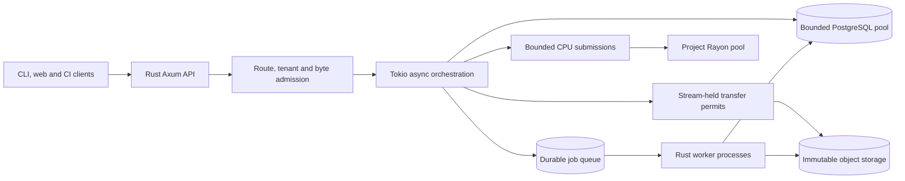

# Rust backend: scaling design and research decisions

**Decision date:** 16 October 2026. **Status:** planning, with no implementation or benchmark results.\
**Selected:** Rust for the server, server-side VCS algorithms, workers and future regional server caches. The proposed Go CLI and React frontend communicate through the API; their languages are separate decisions.

**Durability follow-up:** the [ACID/workflow plan](durability-and-workflows.md) tightens critical metadata mutation isolation to `SERIALIZABLE` initially and specifies acknowledgment/failover profiles. The [implementation roadmap](implementation-roadmap.md) requires early PostgreSQL/Temporal/Restate experiments and later real-integration qualification; no engine is a prerequisite for database correctness. DBOS remains a dated watch-list candidate.

## 1. Proposed Rust stack

| Concern | Starting choice | Reason and boundary |
| --- | --- | --- |
| Network/runtime | Tokio multi-thread runtime, Axum, Tower/tower-http | Async network/database orchestration with explicit admission and transport limits. |
| SQL | SQLx `PgPool`, explicit SQL, PostgreSQL | Keep transactional rules visible. Compile-time query checks for stable queries; offline query metadata checked against migrations in CI. |
| CPU algorithms | Small project-owned Rayon pool, bounded submissions | Isolate graph/diff/merge/compression from I/O scheduling. Extract expensive jobs into a worker process when needed. |
| Object storage | `object_store` crate behind a narrow adapter | Spike filesystem and S3 support; retain provider-specific precondition/durability tests. Use AWS SDK directly only for a concrete adapter gap. |
| Local file I/O | Ordinary Tokio/bounded blocking I/O by default | Evaluate Tokio's experimental io_uring support and isolated `tokio-uring` in F3; adoption requires measured benefit and the same resource/durability gates. See the [I/O evaluation](#local-file-io-and-io_uring-evaluation). |
| Object/metadata cache | Moka async cache with custom weights and admission rules | Small immutable entries, coalesced local misses and bounded best-effort cache size. Large blobs stream or use a later disk cache. |
| API contract | Axum HTTP/JSON, binary object routes, OpenAPI | Keep the existing public protocol. Evaluate Utoipa/utoipa-axum for producing a committed schema and CI drift checks. Generate Go/TS clients from the reviewed schema. |
| Observability | `tracing`, structured logs, metrics and compatible OTel/OTLP export | Measure downstream wait separately from execution. Pin compatible crates; telemetry queues must remain bounded. |
| Durable jobs | Postgres outbox/queue with fenced claims | At-least-once execution, idempotent effects and token-checked publication. No broker required initially. |
| Long-running orchestration | PG/Temporal/Restate comparison at F2, real integration at M4 | Optional durable waits/recovery; domain SQL transactions remain authoritative. Required fault, retention, upgrade and restore cases are in the [workflow test plan](workflow-evaluation-plan.md). |

Relevant primary APIs: [SQLx pooling](https://docs.rs/sqlx/latest/sqlx/struct.Pool.html), [object_store](https://docs.rs/object_store/latest/object_store/trait.ObjectStore.html), [Rayon pool builder](https://docs.rs/rayon/latest/rayon/struct.ThreadPoolBuilder.html), [Utoipa/Axum integration](https://docs.rs/utoipa-axum/latest/utoipa_axum/). These establish available interfaces, not comparative performance. Keep `tokio-postgres` plus Deadpool as the SQL alternative if SQLx's schema/build workflow causes an observed problem.

Use a Cargo workspace with server crates/modules for domain formats, graph/trees, storage, transactions/policy, jobs, HTTP and operations. Start with a few coarse modules; split crates where dependencies/build/test boundaries justify it. Share Rust libraries between server execution modes. Across Rust and Go, share schema, canonical test vectors and behavioral fixtures, with no FFI or duplicate authoritative merge engine.

## 2. Four separate scaling dimensions

| Workload | Scaling mechanism | What remains constrained |
| --- | --- | --- |
| Interactive metadata reads | API replicas, efficient queries, immutable page caches and batching | Authorization/membership checks and underlying metadata capacity. |
| File materialization | Bounded object streams, batched small objects, eventual node/regional caches | Storage QPS/bandwidth, client disk and network; warm-cache results do not establish cold capacity. |
| Derivation/diff/merge | Incremental algorithms, bounded CPU workers, queue classes | Per-job memory, parent dependencies, hot-directory cost and available cores. |
| Ref/landing writes | Parallel independent refs/repos, short SQL transactions | One target's ordered policy/check/CAS path and primary database capacity. |

Rust gives useful control over local resources. Horizontal source-control capacity still depends on data layout, coordination, storage and workload. API replica count alone cannot establish a supported monorepo size.

## 3. Execution and admission



**Admit before allocating.** Bound active handlers, queue length, body size, decoded metadata, stream count, storage operations, CPU submissions and temporary disk bytes. Authenticated tenants get class quotas; unauthenticated requests also need a coarse ingress bound. Return structured overload responses with retry guidance. Map Tower errors into HTTP responses rather than letting middleware failures simply close connections. [Axum error handling](https://docs.rs/axum/latest/axum/error_handling/index.html).

Use shared process-wide semaphores where limits must apply across routes. Tower documents the distinction between [global/shared](https://docs.rs/tower/latest/tower/limit/concurrency/struct.GlobalConcurrencyLimitLayer.html) and per-service limits. Separate short metadata requests, bulk transfers and SSE: an idle event stream must not consume the entire interactive-request allocation. Long waits happen in the durable job queue, not a population of unbounded in-memory futures.

Move CPU and memory permits into the actual job, acquiring them **before** materializing its input. Release on real job exit. A request timeout must not release those permits while its computation continues. Use cooperative cancellation checks in bounded algorithm steps. If hard cancellation is necessary for hostile/large work, use an isolated worker process with a termination/retry policy. Tokio documents that a running [`spawn_blocking`](https://docs.rs/tokio/latest/tokio/task/fn.spawn_blocking.html) closure cannot be aborted. Reserve it for bounded blocking I/O/adapters; it is not the CPU scheduling policy.

Do not block an async thread with `Rayon::install` while waiting for results. Submit admitted work through a nonblocking bridge and await its result. Rayon's fixed worker count does not limit queued jobs or retained inputs. Graph algorithms should load bounded page batches asynchronously and compute in steps, rather than materializing the full repository into a CPU closure. Avoid unbounded parallel recursive directory traversal.

Cancellation is observed through explicit tokens, body/write failures and task lifecycle handling; a socket disconnect is not a universal guarantee of immediate application cancellation. A committed mutation remains durable even if its response is lost; callers reconcile by idempotency key. Keep repository-wide mutexes and locks held across `.await` out of the hot path. Lock only narrowly scoped state for short updates.

### Local file I/O and io_uring evaluation

**Decision:** retain the normal multithreaded Tokio service as the MVP default. Evaluate io_uring for the filesystem object adapter, upload staging and future disk caches. This is a planned optimization experiment, not a selected runtime change or a measured speedup. PostgreSQL transaction contention, hot-ref coordination and CPU-heavy algorithms require their existing solutions; changing application file I/O does not accelerate PostgreSQL's internal storage engine.

There are two distinct candidate implementations:

- **Tokio's own experimental support:** current filesystem documentation describes Linux io_uring support requiring `tokio_unstable`, the `io-uring` Cargo feature and runtime configuration. Verify the pinned release's operation/platform coverage; do not infer that every `tokio::fs` call uses it. The basic installation must not require unstable APIs. [Tokio file-read documentation](https://docs.rs/tokio/latest/tokio/fs/fn.read.html), [runtime builder](https://docs.rs/tokio/latest/tokio/runtime/struct.Builder.html#method.enable_io_uring).
- **Separate `tokio-uring` crate:** the documented 0.5.0 runtime is current-thread, with additional runtime threads for parallel execution, mostly non-`Sync` resource types and APIs that take ownership of buffers until operation completion. Its docs specify Linux kernel 5.10 or later; qualify actual kernel, filesystem and container policy rather than treating that minimum as a deployment certification. [Official API](https://docs.rs/tokio-uring/0.5.0/tokio_uring/), [project repository](https://github.com/tokio-rs/tokio-uring).

Neither option automatically converts Axum, SQLx or an S3 HTTP/TLS client to io_uring. Confirm which calls the actual `object_store` adapter makes. An experiment must prove its intended path is exercised; changing a runtime flag while the adapter still uses another blocking path is not a valid comparison. A specialized local adapter may be necessary, but preserve the public storage contract and provider-specific publication rules. Do not introduce a second service-wide runtime merely to benchmark local files.

**F3 experiment:** compare a tuned ordinary Tokio/bounded-blocking implementation, Tokio's supported experimental operations and a small isolated `tokio-uring` implementation. For the isolated arm, use dedicated runtime threads and a bounded bridge carrying owned requests/buffers; validate `Send`/thread-affinity boundaries and shutdown explicitly. Keep experimental build/runtime settings out of the default distribution. Record unsupported cases instead of requiring experimental feature adoption to pass feasibility.

| Test | Required comparison or observation |
| --- | --- |
| Small random reads | Blob/tree-page reads across object counts and sizes, batch sizes and queue depths; test open/read/close costs and cold versus warm page cache. |
| Large transfers and staging | Streaming reads, upload spool writes and cache fills under equal concurrency, buffer/temporary-disk budgets and durability settings. Do not use a whole-file `read` convenience API as the only streaming benchmark. |
| Mixed service load | Read API and materialization latency while writes/derivation run; identify CPU, scheduling, filesystem, device, network or origin bottlenecks. Include end-to-end service requests, not only isolated IOPS. |
| In-flight cancellation and shutdown | Drop/time out a caller during submitted I/O; retain operation-owned buffers, file descriptors and byte/concurrency permits until completion or confirmed cancellation. Repeated timeouts cannot bypass admission. Drain or terminate according to an exercised recovery policy. |
| Unavailable io_uring | Probe required operations on each supported deployment profile, including denied/unavailable ring setup. Default installation remains usable through ordinary I/O; explicitly requested modes either report a documented fallback or fail clearly before accepting work. Never hide real data-integrity/storage errors as harmless fallback. |
| Durability and faults | Re-run partial-write, disk-full, interrupted upload, sync/rename/directory-persistence, SQL-publication and lost-response tests. Preserve raw digests, immutable keys and acknowledged-object reachability. No fast arm may disable sync or change the acknowledgment contract. |

Capture exact crate/compiler/kernel/filesystem/device/container settings, data sizes/seed, caching and direct/buffered-I/O mode, submission depth, thread counts and all admission budgets. Compare p50/p95/p99, logical throughput, CPU, context switches, blocking-pool wait, device latency, retained RSS/buffers and rejected load. Treat direct I/O, registered buffers or polling as separate controlled variants; do not attribute their effects to a runtime swap alone. Preserve CPU capacity for API/SQL work when allocating runtime threads.

**Adoption gate:** set a meaningful end-to-end improvement threshold and allowable tail/resource regressions before the comparison, then retain the simplest implementation meeting it. F5 records the preliminary choice, M1 qualifies the real adapter's durability, M8 re-runs mixed-load/cancellation/recovery against the selected release, and S3 revisits it for disk-cache workloads. A result limited to local NVMe must not be advertised as an S3 or overall enterprise speedup.

An io_uring write completion is not a power-loss durability guarantee. Required file/directory synchronization and object-before-SQL publication remain intact. No I/O mechanism changes the ACID unit, workflow-engine decision or backup/restore requirements.

## 4. Streaming and memory

Tower's request concurrency permit is released when the response future produces its result, before a streaming response body necessarily completes. A body wrapper must retain a separate stream permit through completion/drop. Enforce stream count, byte retention, idle deadlines and overall transfer policy independently. [Tower response-future implementation](https://docs.rs/tower/latest/src/tower/limit/concurrency/future.rs.html).

Direct raw-body routes need running byte counters and configured limits; Axum's extractor [`DefaultBodyLimit`](https://docs.rs/axum/latest/axum/extract/struct.DefaultBodyLimit.html) does not cover every raw `Body` consumer. Never trust `Content-Length` alone. Cap decoded size and decompression work as well as bytes received.

Preserve backpressure through each stage: network frame -> length/hash accounting -> bounded storage part/write. HTTP frames are not fixed application chunk sizes; split/rechunk oversized frames before retaining them and account for transport/SDK buffering. A small slice can retain a large shared backing allocation: account for the full retained allocation or copy into genuinely bounded buffers. Multipart backend uploads may require multi-megabyte parts even when application frames are smaller. Budget those parts and SDK retries explicitly; a 256-KiB frame size does not make a multipart stream use only 256 KiB.

Temporary-file spooling is acceptable for resumability or retryable SDK bodies if bounded by quota and disk space. Abort/expire incomplete uploads without deleting published objects. Do not collect an arbitrary upload or cache miss into a whole-object `Vec`. Enforce the existing raw-object identity/range contract: storage compression and multipart transfer do not change content identity. Preserve upload reservations and verification before SQL publication.

A useful memory model is:

```text
peak retained memory = base process + cache entries still referenced
                     + active stream buffers/SDK parts
                     + admitted and queued CPU input/output
                     + parsed request/response data
                     + database/HTTP/TLS buffers + allocator overhead
```

Measure RSS/high-water behavior; Rust ownership is not a hard memory quota, and dropping the last application reference need not immediately reduce RSS. Reject new heavy work before exhausting memory or temporary disk. Do not count an evicted `Arc` value as freed while active readers still own it.

**Example configuration for experiments only:** an 8-vCPU/16-GiB test host can begin with 64 active small metadata handlers, 2 MiB request JSON limits, 4 CPU jobs and at most 4 queued CPU jobs, 16 upload streams, 32 download streams, 32 storage operations and a 256 MiB weighted small-object cache. Use a measured retained-byte budget, initially 128 MiB across application transfer buffers, while separately bounding SDK part buffers. Start SSE in a separate small connection class. These are hypotheses to lower or raise from mixed-load tests, not supported-capacity figures. If Postgres and workers share that host, divide cores/memory across all processes rather than granting each the whole host.

## 5. PostgreSQL capacity and job fencing

Use one SQLx pool per intended connection class/process and clone handles to it. Keep SQL transactions short, with query/lock/acquisition deadlines. Never hold a connection while uploading/downloading, waiting for CI or executing a large algorithm. SQLx query checking is a development guard, not proof that transaction invariants are correct.

Correctness-critical domain mutations now start at `SERIALIZABLE`, with full retry handling, stable idempotency outcomes and necessary constraints/CAS. Profile retry/lock costs under the actual workload before considering a reviewed lower-isolation optimization. This is distinct from a workflow engine's durable retry semantics.

Budget connections at **maximum deployment size including rollout surge**:

```text
sum((steady replicas + rollout surge) * per-replica pool maximum)
    + non-application clients <= database connection limit - operational reserve
```

Here the per-replica maximum is the **sum of all pool maxima in that process**, including separate interactive/worker/administrative connection classes. Cloned handles to the same pool do not count as independent pools.

Example: for a test DB budget of 64 connections with 16 reserved, five API processes (including surge) at 8 connections plus two workers at 4 consume all 48 application slots. An extra replica requires rebudgeting. This is arithmetic, not a recommendation to configure every Postgres instance to 64. Keep health/administrative access viable under saturation.

Claim jobs in short transactions using `SKIP LOCKED`, record lease plus monotonically increasing attempt/fencing token, then release the connection. A lease expiry allows a replacement; it cannot stop the previous process. Every completion/index/ref publication must check that token and expected state transactionally. Immutable duplicate object writes are tolerable; stale workers advancing refs are not. [Postgres queue-locking semantics](https://www.postgresql.org/docs/current/sql-select.html).

Keep interactive manifest derivation, bulk index rebuilds/imports and landing in different queue classes with bounded shares. Protect short jobs from large history scans. Parent dependencies must be visible and resumable; avoid recursive request-time fanout that reconstructs all history after a cache miss.

The existing landing transaction still validates target generation, candidate/check/review versions and current policy. Use shared reads/locks for stable policy generations where appropriate and exclusive updates for revocation, following a single lock order. Do not introduce a long-lived exclusive repository lock for every operation merely because one policy-generation row exists. Measure policy-row, job-claim and target-ref contention separately.

If Temporal or Restate is adopted, retain atomic domain/outbox dispatch, idempotent workflow starts and domain commands, and a single fenced controller per operation. Give workflow persistence its own pool/IO/retention budgets; it cannot make the domain DB and object store one transaction. The [durability plan](durability-and-workflows.md) adds synchronous-ack profiles and cross-engine restore reconciliation.

## 6. Data structures and caches

Canonical first-parent deltas, ready snapshot roots, paged persistent directories and ordered graph edges remain the starting model. Derivation must update changed pages and ancestors. Freeze the logical format using cross-language vectors; tune page layout separately. Benchmark huge directories, deep trees, long ancestry and many concurrent children of one parent before choosing graph accelerators or durable page sizes.

Moka supports custom entry weights through [`CacheBuilder::weigher`](https://docs.rs/moka/latest/moka/future/struct.CacheBuilder.html). Use estimated retained bytes for immutable small objects, enforce a per-entry admission threshold and monitor eviction lag. Weighted capacity is approximate, not a hard RSS bound. [`get_with`/`try_get_with`](https://docs.rs/moka/latest/moka/future/struct.Cache.html) can coalesce a same-key miss within one cache instance. This does not coalesce across replicas.

Cache keys include repository, object/type and representation/derivation version. Authorize repository access and membership before disclosing cached bytes. Batch authorization/membership work for object batches rather than performing a SQL round trip for every frame. Revocation semantics remain explicit; cache warmth must not extend access accidentally. Mutable refs and policy decisions cannot become authority merely because they are cached.

Add a node or regional cache only when measured reuse/avoided origin load justifies it. It needs bounded disk/memory, miss coalescing, request quotas and a protected origin fallback. A failed regional cache must not unleash unbounded upstream fetches. Per-process semaphores do not enforce fleet-wide quotas: allocate budgets through bounded deployment sizes or enforce shared tenant/storage limits at a queue/gateway/provider boundary.

## 7. Deployment stages and scale decisions

| Stage | Deployment | Evidence required for the next step |
| --- | --- | --- |
| Self-hostable MVP | One Rust binary/image with `serve` combined mode and `api`/`worker` modes; Postgres; filesystem or tested S3 adapter | Install/restore correctness and stable memory/latency under the declared pilot workload. Combined mode still has independent execution budgets. |
| Pilot isolation | API and worker in separate processes/containers on one or more hosts | CPU jobs no longer starve interactive traffic; lease/fencing tests pass with multiple workers. |
| Organization read/compute scale | Multiple API replicas, worker classes, Postgres HA, replicated object storage | Load tests identify the API/worker tier as the constraint and demonstrate downstream headroom. |
| Checkout-heavy fleet | Regional/node immutable caches and prewarming | Object reuse and origin bytes/QPS justify cost; cache-outage test preserves origin health. |
| Many repositories | Route each repo to its owning metadata primary/shard | Migrate placement safely, preserving repo-local transaction boundaries and recovery. |
| One enormous/hot repo | Separate graph/index placement experiment; potentially FoundationDB/TiKV | Demonstrated single-repo metadata bottleneck after query/index/vertical tuning. Benchmark a different storage model before committing to it. |

A separately deployable Rust `cache` process mode is explicitly deferred until the checkout-heavy stage. It can share the binary/image then; the first release only needs in-process caching and `serve`/`api`/`worker`. A node daemon remains a separate client-side decision.

CPU saturation plus growing worker-ready age can justify more workers **only while** database/storage headroom exists. API latency dominated by SQL wait calls for downstream investigation. A cache improves only repeated objects; it does not cure write contention or inefficient graph algorithms. Required CI wait and hottest-target queue age are separate from VCS compute latency.

FoundationDB/TiKV are later candidates, not drop-in Postgres replacements. Rust bindings, transaction limits, key layout, secondary indexes, native dependencies and restore operations require evaluation. Splitting only graph metadata can also introduce new atomicity boundaries with review/ref/policy data. No storage choice removes the serialized update to one mutable ref. See the [storage memo](research/rust-storage-scaling.md) for binding and transaction constraints.

## 8. Operational and verification gates

Start with structured `tracing` spans and bounded-cardinality counters/histograms: admission/rejection, per-class queue age, active streams/bytes, CPU job duration, pool wait, SQL/WAL/lock time, storage calls, cache reuse, memory and restore age. Put object/repo identifiers in sampled, access-controlled traces rather than metric labels. Review current [OpenTelemetry Rust maturity](https://opentelemetry.io/docs/languages/rust/) and pin a compatible instrumentation/exporter set. Runtime metrics and profiling are diagnostic aids; do not require unstable Tokio APIs for a basic installation.

Preserve the main plan's provisional small-change acceptance/readiness objectives. The operations memo proposes additional pilot SLOs; **bulk job freshness thresholds are not the latency target for interactive manifest readiness**. Choose route/payload classes, availability denominator and RPO/RTO before claiming an SLO. At declared load, overload rejections must count as unsuccessful valid requests rather than being hidden from availability.

| Proposed objective | Disposition |
| --- | --- |
| Small changeset acceptance p95 < 500 ms, excluding upload/tree/CI | Retain the existing main-plan benchmark target; unmeasured. |
| Warm-parent, 10-file snapshot readiness p95 < 2 s | Retain; measure queueing plus execution, not just worker runtime. |
| Bounded metadata reads p95 < 300 ms / p99 < 1 s | Candidate pilot target; validate at declared payload/load and cold/warm cache mix before adoption. |
| Valid interactive-request availability 99.5% over 28 days | Candidate pilot SLO; defer a published promise until topology/operations support it. |
| 99% of small durable mutation outcomes < 2 s, excluding upload/long jobs | Candidate tail objective alongside the stricter p95 acceptance target; reconcile route definitions in the benchmark specification. |
| Bulk ready-job age p95 < 60 s; investigate oldest-ready > 5 min or growth for 10 min | Candidate bulk queue dashboard thresholds, excluded from interactive readiness promises. |
| Metadata RPO <= 5 min and service RTO <= 4 h | Deferred examples, not adopted recovery guarantees. Select settings and rehearse joint database/object recovery before declaring them. |

| Experiment | Required result |
| --- | --- |
| Mixed interactive + bulk + CPU overload | Memory/queues remain bounded; cheap reads retain their reserved share; work sheds with structured errors. |
| Slow or disconnected streaming clients | Transfer permits survive through body lifetime, then release; buffering stays within budget; no partial publication. |
| Request timeout during CPU work | CPU/memory permits stay held until actual job exit; cancellation checkpoints work; no oversubscription from repeated timeouts. |
| Local I/O implementation comparison | Equal durability and resource budgets; confirmed code paths; in-flight buffers/permits survive caller cancellation; unsupported deployments have a documented ordinary-I/O path. |
| One-process and multi-replica cold misses | Measure local coalescing and fleet origin fanout; cache outage does not overwhelm the backend. |
| One ref versus many refs/repos | Exactly one successful transition per expected generation; record hot-ref serialized time separately from aggregate capacity. |
| Worker pause/lease expiry/reclaim/resume | Old token cannot publish after a newer claim; duplicate jobs converge on one logical outcome. |
| SQLx pool and cancellation saturation | Finite connection/queue use, bounded wait, recoverable outcomes and healthy administrative access. |
| Directory/graph shape sweep | One-file edits avoid whole-manifest rewrites; index fallbacks have work limits; rebuild costs are published. |
| Rolling upgrade + failover + restore | N/N-1 compatible schema, reader-first format rollout, reconciled uncertain commits and full retained-object scrub. |

Use property tests for canonical/tree invariants, process-level fault tests against real storage for distributed behavior, and optimized end-to-end load tests for capacity. Loom applies to deliberately modeled in-process synchronization; Turmoil needs network adapters and does not automatically simulate SQL/S3. Criterion microbenchmarks help isolate kernels but cannot establish service capacity. The [operations memo](research/rust-operations-scaling.md) documents these tools and limits.

## 9. Next implementation experiments

1. Rust HTTP + SQLx + object-store spike with explicit request/stream/pool budgets; validate generated Go/TS clients against the OpenAPI artifact.
2. Compare a small bounded Rayon path with a separate CPU worker under mixed traffic; test cancellation and permit lifetime.
3. Implement the delta-to-paged-manifest reference model and cross-language vectors; test wide-directory updates and parent dependency fanout.
4. Exercise SQL CAS/outbox/lease-fencing with two workers, injected pauses and lost responses; retain the original durability and backup/GC gates.
5. Replay one realistic hot repository and many independent repositories, with cold/warm/cache-outage runs. Report which resource limits each envelope.
6. Run the [three-arm workflow experiment](workflow-evaluation-plan.md) early, using the same Rust domain commands and faults. Re-test the selected approach with real landing, then with enterprise HA/mixed-load topology in the roadmap gates.
7. Run the [local I/O evaluation](#local-file-io-and-io_uring-evaluation) as part of F3: ordinary Tokio versus its experimental io_uring support versus isolated `tokio-uring`. Carry any selected optimization through M1/M8 correctness and recovery gates; revisit disk-cache I/O in S3.

Record host/container quotas, compiler/release profile, crate versions, schema, dataset, proxy and backend configuration. No fixed performance gain or enterprise capacity is inferred from selecting Rust.

## 10. Review of the Luna findings

Three Luna agents researched [storage](research/rust-storage-scaling.md), [runtime](research/rust-runtime-scaling.md) and [operations](research/rust-operations-scaling.md). The primary agent read each memo, checked additional upstream sources and made these synthesis decisions:

- Accepted Tokio/Axum/Tower, SQLx-first, `object_store` evaluation and bounded CPU execution; libraries remain version-pinned implementation spikes, not certified dependencies.
- Corrected the runtime memo to include Moka's custom weights and best-effort capacity, retain CPU permits after request cancellation, and avoid assuming socket close universally cancels application work.
- Added explicit stream-lifetime permits, multipart SDK-buffer accounting and rollout-surge connection arithmetic to make resource limits meaningful.
- Kept the original maintenance-only GC and coordinated backup gates. No Rust runtime feature closes the SQL/object-store transaction gap.
- Kept original interactive readiness objectives distinct from the operations memo's bulk queue-age proposals. All numeric defaults/SLOs remain unmeasured hypotheses.
- Retained separate hot-repo and many-repo scale gates and the existing single-target landing policy. The language decision does not reopen CLI language or imply a distributed database is now necessary.

Each Luna agent also reviewed this synthesis. No material correctness contradiction was reported. Their clarifications were incorporated: sum all per-process SQL pools, distinguish future cache-mode scope from MVP modes, enumerate SLO dispositions, and account for retained large frame allocations. Remaining findings concern implementation proof and measurements, as captured in the experiment gates.

The remaining unknowns are the real workload/corpus, supported crate/provider versions, measured per-job memory, database envelope and recovery objectives. Those are executable experiment gates for the selected Rust server design.
