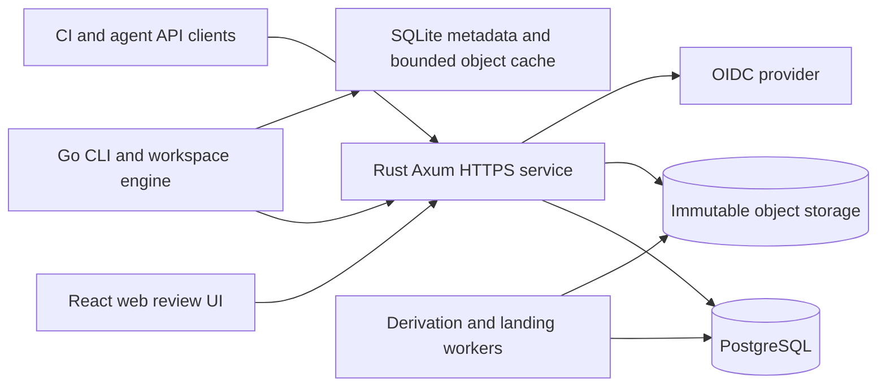

# Open Scion: research-backed technical plan

**Date:** 16 October 2026\
**Status:** proposed architecture; research only, no implementation or performance measurements.\
**Server language decision:** Rust, selected by the user on 16 October 2026. The CLI remains proposed as Go; the frontend remains React/TypeScript.\
**Reliability requirement:** ACID authoritative metadata mutations and explicit object/acknowledgment durability; PostgreSQL owns domain correctness. Evaluate Temporal and Restate against PostgreSQL workers early in F2, then qualify the selected approach against real review/CI/landing in M4. See [durability and workflows](durability-and-workflows.md) and the [workflow test plan](workflow-evaluation-plan.md).\
**Product direction:** start with a small-team, self-hostable MVP and preserve a credible path to a large-organization platform. C and C++ are excluded as implementation-language candidates, per the user's preference. The name and `oscn` command below are provisional.

## 1. Recommended direction

Build an **online-first source-control service with a sparse native client, a web review application, and a documented API**. Start with one deployable backend and workers, PostgreSQL, and immutable object storage. Make no-checkout operations useful early, and keep Git import/export as an explicit migration boundary.

The current stack is **Rust for the server and server-side workers; Go for the proposed CLI; React + TypeScript + Vite for the frontend; PostgreSQL for transactional metadata; filesystem/S3-compatible storage for immutable objects; SQLite for local client metadata**. Use Tokio, Axum and Tower for server I/O and middleware, with bounded CPU execution for repository algorithms. The client cache runs in-process initially; a shared daemon is an optional later extraction. Keep one HTTP API, an OpenAPI contract, and streaming binary object transfers. See the [Rust backend scaling plan](rust-backend-scaling.md) for the concrete execution, storage and deployment design.

The first milestone should compare a thin Git-backed service, a small native-format prototype, and a time-boxed Mononoke evaluation. Proceed with a new engine only if it demonstrates useful benefits and an achievable migration path. A custom VCS is a much larger undertaking than a Git UI.

## 2. What the Scion article establishes

Anthropic describes an online, server-authoritative VCS: immutable file-delta changesets, content-addressed blobs, derived indexes, demand-fetched tree/blob objects, and sparse or virtual working copies. Ref updates are separate from changeset creation. Node and regional caches reduce repeated transfers. Its account reports substantial gains on its own workload, credits Mononoke/Bonsai, and warns that adopting its model entails changes across development infrastructure. These are published architectural observations, not an available implementation, a protocol specification, or evidence of equivalent results for this project. The article appeared October 13 and was updated October 15, 2026. [Anthropic's source](https://www.anthropic.com/engineering/redesigning-source-control).

The following sections are **our proposed design**, including storage, protocols, merge policy, security, deployment, and roadmap. They should not be read as undocumented Scion internals. We do not know its exact serialization, algorithms, consistency protocol, operational costs, or migration guarantees.

## 3. Research conclusions and build-versus-reuse

| Route | Why evaluate it | Decision for this plan |
| --- | --- | --- |
| Git plus service-side APIs, partial clone, sparse checkout | Lowest migration cost; supplies a realistic baseline | Build a read/API pilot and benchmark first. This could remain the product if it meets demand. |
| Adopt/fork Mononoke with Sapling | Closest existing public architecture; avoids inventing every VCS primitive | Time-box build, import, API, operations, and licensing feasibility. Its external-support caveats prevent assuming a turnkey deployment. |
| New native service and client | Best freedom to simplify online/API workflows and self-hosting | Recommended direction if the early feasibility gates pass; largest correctness and adoption burden. |
| Jujutsu as the foundation | Valuable Git-backed client UX and immutable-operation ideas | Evaluate as an adoption/client reference. Its existing Git backend does not supply the proposed centralized service. |
| Google's Piper/CitC research | Historical context for the organizational tradeoffs of a central monorepo | Publication record reviewed; full paper inaccessible in this pass, so no CitC filesystem claims inform our implementation choices. |

Git's own [partial-clone](https://git-scm.com/docs/partial-clone) and [sparse-checkout](https://git-scm.com/docs/git-sparse-checkout) documentation distinguish missing repository objects from omitted working files. Meta's [Sapling README](https://github.com/facebook/sapling) identifies Mononoke/EdenFS as externally unsupported and documents mixed licenses. The [Mononoke README](https://github.com/facebook/sapling/blob/main/eden/mononoke/README.md) lists omitted OSS functionality; its [architecture documentation](https://github.com/facebook/sapling/blob/main/eden/mononoke/docs/1.3-architecture-overview.md) is particularly useful prior art for separating canonical data, indexes, protocols, and mutable state. See the [prior-art memo](research/prior-art.md) for detailed comparisons and source links.

**Reuse libraries and external tools, rather than copying an entire VCS casually.** The owner selected [Apache-2.0](../LICENSE) for project-owned work during repository setup. Do not copy GPL-licensed Sapling/Mononoke implementation into this permissively licensed codebase without resolving the license implications. Some subprojects have different terms. A Mononoke fork is a possible license-dependent path, subject to a per-component/dependency inventory; it is a different plan from a permissive independent implementation. Third-party service and dependency licensing remains a separate adoption gate.

## 4. Language and component stack decisions

### Systems-language comparison

These are suitability judgments under the small-team-first assumption. Rust is now the selected server language; the table retains the comparison behind the earlier recommendation. No comparative service benchmark has been run.

| Candidate | Backend fit | CLI/cache fit | Main tradeoff and decision |
| --- | --- | --- | --- |
| **Go** | Credible API/service alternative; earlier default favored delivery simplicity | Remains the proposed portable CLI language | GC and allocation behavior require profiling and bounded buffers. Interoperability with the Rust server uses a generated API contract and format test vectors. |
| **Rust** | Selected for server-side storage, graph algorithms and resource control | Remains a possible future client decision | Ownership is useful but does not prove distributed correctness. Keep all server-side domain algorithms and workers in Rust; no Go server or cross-language FFI is required. |
| **C# / .NET** | Credible alternative with ASP.NET Core and a broad tooling ecosystem | Native AOT can improve distribution/startup options | AOT has reflection, dynamic-code and platform constraints. Prefer it if contributor expertise is .NET; benchmark deployment and library compatibility. |
| **Java / Kotlin on JVM** | Credible enterprise service option; virtual threads help blocking-I/O concurrency | Usable, but JVM packaging or native-image work adds client distribution decisions | Good with existing JVM expertise; not selected for this project's Rust backend. |
| **Swift** | Real server option through SwiftNIO and server frameworks | Particularly attractive for Apple-focused tools | Verify all required target platforms and third-party packages. A smaller project-specific ecosystem is an integration risk; not the cross-platform default. |
| **Zig** | Offers explicit allocation and low-level control | Attractive tooling/cross-compilation possibilities | Manual memory management and integration effort increase the burden for an internet-facing VCS. Evaluate only for a measured isolated need, rather than selecting it for the whole MVP. |

Evidence anchors: [Go documentation](https://go.dev/doc/), [Rust ownership](https://doc.rust-lang.org/book/ch04-00-understanding-ownership.html), [.NET Native AOT and limitations](https://learn.microsoft.com/en-us/dotnet/core/deploying/native-aot/), [JVM virtual threads](https://docs.oracle.com/en/java/javase/25/core/virtual-threads.html), [Swift on Server](https://www.swift.org/documentation/server/), [Zig overview](https://ziglang.org/learn/overview/). The language/runtime features are documented facts; the rankings above are our inference. See the expanded [backend](research/backend-stack.md) and [client](research/clients-and-frontend.md) assessments.

### Proposed component choices

| Component | Initial choice | Reason / alternative |
| --- | --- | --- |
| API, workers and VCS domain logic | Rust + Tokio + Axum + Tower; small explicit traits | One server-side domain implementation; async I/O separated from bounded CPU work. |
| SQL access | PostgreSQL with SQLx `PgPool`; explicit SQL and migrations | Keep transactions/CAS visible and enforce a fleet-wide connection budget. [SQLx pool](https://docs.rs/sqlx/latest/sqlx/struct.Pool.html). |
| Immutable storage | Local filesystem adapter for development/single-node MVP; tested S3 adapter for production | Same object interface, immutable keys, checksums and durability contract. Local mode is single-node storage, not HA. |
| Local I/O optimization | Ordinary Tokio/bounded blocking I/O initially | F3 benchmarks Tokio's experimental io_uring support and isolated `tokio-uring`; optional adoption only with measured benefit, compatible deployment and unchanged durability/resource guarantees. |
| Jobs and event delivery | Postgres job/outbox tables and bounded Rust workers | Lease/fencing and idempotency remain mandatory. Compare PG workers, Temporal and Restate in F2; finalize selected lifecycle integration in M4. Engines do not replace SQL transaction boundaries. |
| Public API | HTTPS JSON/OpenAPI; separate binary upload/download endpoints; SSE for events | Browser, CLI and integrations share one contract. [oapi-codegen](https://github.com/oapi-codegen/oapi-codegen), [openapi-typescript](https://openapi-ts.dev/introduction). |
| CLI | Go + Cobra, generated API client, explicit exit codes and JSON output | Share protocol/format specifications and conformance vectors with Rust; no assumed in-process library sharing. [Cobra](https://github.com/spf13/cobra). |
| Local state | SQLite and immutable object files, per OS user | Workspace manifests, recovery journal, cache inventory; dirty user work is never disposable cache. [SQLite WAL](https://www.sqlite.org/wal.html). |
| Web application | React + TypeScript + Vite; router and server-state query library | Static same-origin application with no initial SSR requirement. Next.js is justified if public/SSR pages become a requirement; Svelte is reasonable with existing team expertise. |
| Diff surface | Server-generated hunks; lightweight unified renderer; lazy Monaco for opened files | Keep authoritative diff semantics on the server and bound browser work. Evaluate CodeMirror as a smaller editor alternative. |
| Identity | OIDC provider integration, server-side browser sessions; scoped CLI/CI tokens | Reuse an identity provider. Use PKCE/external browser login for native clients. |
| Packaging/operations | OCI image; Compose quickstart; signed CLI release artifacts; structured logs and metrics | A simple installation path first. Add HA deployment examples and then Kubernetes manifests when needed. |

Lock dependency versions and supported compiler/platform versions during implementation; research links to `main` and `latest` are not a release bill of materials.

The SQLite driver is an explicit portability spike: verify supported architectures, concurrency, backup behavior and build requirements before claiming static or cross-compiled release binaries. Go as the application language does not make every dependency pure Go. The C/C++ exclusion applies to our implementation-language choices; established dependencies such as PostgreSQL and SQLite remain proposed components.

For a concrete self-hosted S3 integration, evaluate **SeaweedFS first**: its primary repository documents S3 service modes and an Apache-2.0 license. It still needs our durability/API/restore tests; its published throughput is not evidence of performance for this workload. [SeaweedFS](https://github.com/seaweedfs/seaweedfs). **Garage** is another self-hosted candidate, with AGPL-3.0 licensing and a different operational/consistency contract to verify. [Garage repository](https://github.com/deuxfleurs-org/garage). Do not default to an old MinIO tutorial: the current public repository is archived and marked unmaintained. [MinIO repository status](https://github.com/minio/minio). Managed S3 is an optional deployment alternative, not a requirement to run the tool.

**Why not start with gRPC everywhere?** Axum HTTP/OpenAPI suits the initial browser, CLI and object-fetch API. If later measurements justify typed RPC, evaluate Tonic with [Tonic-Web](https://docs.rs/tonic-web/latest/tonic_web/) for browser access, including its streaming limits. The earlier Connect-Go option is not the selected Rust server implementation. Do not add a Go gateway or parallel public API merely to preserve the prior language choice.

## 5. Product scope and developer workflow

### Self-hostable MVP

- Native CLI support starts on Linux and macOS; the web application is browser-based. Windows native workspace support is a separate tested release milestone.
- One organization installation with multiple repositories and repo-level reader, writer, reviewer, maintainer and administrator roles.
- Immutable native changesets; trunk and release refs; local workspaces point directly to changesets without requiring a server branch per agent.
- Explicit directory-based sparse materialization, safe status/diff/add/remove/commit, and online server commits.
- Repository browser, commit graph/history, per-file history, lazy diffs, review revisions/comments/approvals/checks, and controlled landing.
- APIs for tree/file reads, ancestry/merge bases, diff, changeset creation and check results; a CI job can request data without cloning.
- Resumable Git ingestion and one-way export for a declared feature subset, verified against named fixtures/pilot repositories and a published compatibility matrix.
- Backup/restore, consistency checking, quotas, authentication, repo authorization and audit records.

**Later:** path-level ACLs, full-text code search, optimized blame, stacked-review automation, shared node caches, distributed metadata storage, fully virtual filesystems, geographic writes, and a transparent Git protocol gateway. Basic file history and bounded on-demand blame can precede a specialized blame index; never disguise an unavailable/expensive query as an empty result.

**Minimum alpha slice:** one pilot repository, read APIs/browser, sparse local work, online commits, one approval rule, one external CI adapter, a simple review/landing flow and tested backup/restore. Broader approval policies, multiple runner adapters, advanced merge/rename behavior, broad Git-fidelity coverage and HA qualification are separate pilot gates. This distinction allows a usable backend/frontend/CLI demonstration before all pilot requirements are complete.

### Proposed CLI flow

```text
oscn auth login --server https://source.example.org
oscn clone team/repository --include services/payments --include libs/common
oscn status
oscn add path/to/new-file
oscn diff
oscn commit -m "Validate payment requests"       # server creates immutable draft
oscn review create --target main
oscn review open
oscn review land --wait                         # queues policy-checked landing
oscn sync                                      # fetch and safely update workspace
```

Also specify `scope add/remove`, `log`, `show`, `file`, `merge-base`, `resolve`, `merge abort`, `cache inspect/prune`, `doctor`, and administrative `import-git`, `export-git`, `fsck`, `backup` and `restore` operations. Separate local and administrative credentials. `commit` never advances protected main by itself; `land` does.

Offer stable `--json`, pagination, noninteractive authentication, deadlines, cancellation, machine-readable conflict details and documented exit codes. Diagnostics go to stderr. Mutations use idempotency keys. Agents use the same permission model as people, with narrower scoped credentials.

`commit` snapshots an explicit workspace parent and an immutable copy of the selected changes. It does not require the current main tip. Edits made while upload runs remain as subsequent dirty work, and a successful response advances only the local recorded base to the accepted snapshot. A lost response is reconciled by operation ID before retry or workspace-state changes. Add `oscn rm` and `oscn restore` with explicit path selection and previews; a dirty restore must preserve a recoverable preimage.

`sync` fetches the chosen target and fast-forwards a clean workspace when possible; a diverged draft or overlapping dirty edits produces an explicit reconciliation requirement. `oscn merge <target>` requests a server merge plan and applies its result through the workspace journal. It creates a new immutable revision after resolution; it never silently rebases published drafts or resolves conflicts. `merge abort` restores the saved pre-merge state while preserving edits made during the operation as recovery data.

**Offline contract:** files already materialized remain editable, and cached base data permits local status/diff. Server commits, missing history and uncached objects require connectivity. A local recovery checkpoint is not an accepted server changeset. Offline commit queues are deferred to avoid a second authority model in the MVP.

## 6. Architecture and deployment boundaries



The worker and API are separate **modules and execution pools**, initially shipped in one Rust binary/image with combined `serve` and separate `api`/`worker` modes. Expensive diff/merge/index tasks must not exhaust the lightweight read pool. No Redis, Kafka, Elasticsearch, Kubernetes or multi-region database is required to install the MVP.

The static web build can be bundled into the server distribution so production does not require a separate Node application. Compose demonstrates one-command installation; production documentation must distinguish process restart from database/object durability and HA.

Rust server crates/modules should follow domain boundaries: object format/storage; changesets/graph; trees; diff/merge; refs; reviews/landing; identity/policy; jobs; API; and Git importer/exporter. Keep the Go workspace engine and local cache in client packages behind the HTTP contract. Transport objects and SQL rows must not become the server domain API. Use a small number of actual persistence traits rather than promising every database backend up front.

Local file I/O remains an adapter decision. The [io_uring evaluation](rust-backend-scaling.md#local-file-io-and-io_uring-evaluation) compares ordinary Tokio with its experimental Linux support and a small isolated `tokio-uring` path for object reads, upload staging and future disk caches. Confirm actual adapter operation coverage; this is not an automatic replacement for HTTP/TLS, SQLx or S3 clients. The default installation retains ordinary Tokio, and experiments cannot weaken synchronization, publication or in-flight buffer/admission rules.

The Rust backend initially ships as one binary/image with API and worker modes. CPU-heavy derivation/diff/merge runs behind bounded admission, separate from Tokio I/O tasks. Streaming requests have their own byte/concurrency limits; adding API replicas must not multiply PostgreSQL connections or worker concurrency beyond shared downstream capacity. The [scaling plan](rust-backend-scaling.md) defines those budgets and the sequence for extracting workers and caches.

The [durability plan](durability-and-workflows.md) makes critical metadata mutations `SERIALIZABLE` by default, with short transactions, explicit generations/constraints and whole-transaction retries. A workflow coordinates domain commands; it never owns refs/policy independently or supplies a transaction across PostgreSQL and object storage. Lower isolation requires an invariant-specific review and test evidence.

For large installations, add an optional per-user/node daemon and regional immutable-object caches behind the object-fetch interface. A cache must preserve authorization, deadlines, integrity checks and backpressure. Use byte-aware process-local caching with request coalescing; evaluate future disk-cache eviction separately. Bound parallel fetches, batch small objects, and never fall through from a failed cache tier to unlimited origin requests. Tiered caches are an evolution target, not a requirement for the first developer installation.

## 7. Canonical data model and invariants

| Entity | Proposed authority and representation |
| --- | --- |
| Blob | Immutable raw file bytes identified by versioned SHA-256; compressed storage encoding is separate from content identity. |
| Changeset | Immutable ordered parents, author metadata, message and sorted file operations relative to **first parent**. Each operation is set-content/mode or explicit delete, with optional copy provenance. |
| Tree/manifest | Derived immutable content-addressed directory representation, mapped from `(changeset, derivation type, version)`. Not a replacement for canonical changeset history. |
| Ref | Postgres row `(repo, name, target, generation)`, conditional update and audit log. |
| Review | Stable review ID with immutable patch revisions; comments anchored to a revision, path, side, line and hunk context. |
| Check/approval | Bound to exact patch revision, candidate ID, relevant target and policy version; mutable authorization/policy rechecked at landing. |
| Workspace | Local base ID, sparse selection, tracked/materialized paths, observed content/modes, conflicts and recovery journal. |
| Durable job/outbox | Transactional pending work with deduplication key, lease, retry budget and completion state. |

Use **domain-separated, versioned hashes over a specified canonical encoding**. A candidate is restricted deterministic CBOR: fixed field identifiers/order, byte-string paths, defined integer ranges, no floating point, no indefinite lengths, explicit absent/default behavior, and published golden test vectors. [RFC 8949](https://www.rfc-editor.org/rfc/rfc8949.html) supplies deterministic encoding rules; the application still needs its own schema. Do not hash ordinary JSON or rely on Protobuf deterministic serialization as a stable identity: [Protobuf explicitly says that serialization is not canonical](https://protobuf.dev/programming-guides/serialization-not-canonical/).

Keep object storage keys repository-scoped even if content digests match across repositories. Validate type, length, digest, path operations and parent membership. Commit identity includes ordered parents; a merge is a complete file delta from its first parent to the resolved result, **not merely its conflict resolutions**. Changes inherited from another parent must appear in that delta whenever they differ from the first parent.

Before durable IDs ship, the format ADR must enumerate every hashed field, raw path-byte sorting and uniqueness, duplicate-operation rejection, file-versus-directory replacement rules, modes/types, timestamp precision, deletes and empty trees. The same changeset must always denote the same path-to-content/mode mapping. A new manifest/index representation may have different page/root hashes, but it must produce the same logical snapshot; a semantic change requires a new changeset format or explicit migration, not merely a new index version. Golden vectors must cover this distinction.

Native creation can initially support zero, one or two parents. Import must preserve arbitrary ordered Git parents, including octopus merges, or reject those repositories in preflight with a precise report. Prefer supporting arbitrary parents in canonical storage/graph from the start; native merge UI can remain two-parent. No automatic rename detection is required for correctness: represent a rename as delete plus add, with optional provenance. Document first-parent history/blame and distinguish full-DAG ancestry from first-parent traversal.

For scalable tree derivation, copy only changed paths and their ancestor nodes. Large directories require bounded pages/sharding (prototype a persistent directory map before freezing the format). Rewriting a million-entry directory for a one-file edit fails the intended goal. Tree lookup must not replay all ancestral changesets; maintain a root manifest per derived revision and version it independently. The paged representation and threshold are an early experiment, not a claimed solved implementation.

## 8. Write path, derived data and consistency

1. Authenticate, authorize, enforce quotas and reserve/lookup an idempotent request keyed by repository, actor and request key. Reuse with a different payload is an error.
2. Upload missing blobs through bounded streams; verify raw-content digests and persist immutable data durably. Repeated uploads are safe. Large-file chunking is deferred until measurement; a chunked blob format would need its own version and retention rules.
3. Validate existing parents, file operations, graph constraints and request ownership. Parent snapshots needed for path validation must be ready; otherwise return a pending operation before acceptance. Store canonical changeset bytes and their object memberships.
4. In a short SQL transaction revalidate current authorization/policy generations, then publish the changeset record, graph edges, durable draft/review retention pin, outbox tasks and idempotent result. Coordinate revocation using the same generation/locking discipline as landing. There is no mandatory ref movement or globally incrementing commit number.
5. Acknowledge the durable changeset ID. Expose snapshot/index state explicitly. Clients may request bounded waiting for tree readiness; expensive derivation can return an operation ID and retry/poll details.
6. Workers derive manifests and later history/blame accelerators with keys `(repo, change, type, version)`. They schedule parent dependencies, claim leases and atomically publish verified results. Crashed or duplicate workers may repeat work safely.

The SQL publication is authoritative; a blob present in storage alone is not a published commit. Object writes precede SQL references, so a failure can create garbage, not a ref to missing content. Persist enough request state to recover the **same** result after a lost response, including any server-added identity/timestamps. Avoid a retry recomputing a different changeset ID.

Changeset publication, idempotent outcome, retention pin and outbox insert form one short ACID SQL transaction. Acknowledgment requires the chosen durable object-store completion and SQL WAL flush; local filesystem adapter flush/rename/directory durability must be qualified explicitly. Metadata publication plus immutable prewrites gives logical service visibility, not a shared physical transaction with S3.

Postgres transactions and S3 PUTs are not a joint transaction. Retention, upload pins and GC rules must bridge that gap. S3 documents [strong read-after-write consistency](https://docs.aws.amazon.com/AmazonS3/latest/userguide/Welcome.html) and [conditional writes](https://docs.aws.amazon.com/AmazonS3/latest/userguide/conditional-writes.html); other compatible stores require conformance tests. A success acknowledgment must match the configured durability objective of both storage systems.

**Reader contract:** changeset metadata is immediately available after acceptance on authoritative reads; tree-dependent operations return ready/pending/failed states, rather than silently using an older tree. A reference to main is published only once its exact tree is ready. Graph edge correctness is synchronous; optional reachability accelerators can lag. Pin query pagination to a changeset/generation. Do not consult a lagging replica for read-after-write correctness without a consistency token or primary fallback.

### Initial API surface

Route names are proposals to finalize in the OpenAPI milestone. Every route is repository-scoped and authorization-checked; mutation credentials and expected versions are explicit.

| Operation | Proposed HTTP shape | Important contract |
| --- | --- | --- |
| Resolve ref | `GET /v1/repos/{repo}/refs/{name}` | Exact target and generation; authoritative or explicitly stale-tolerant read. |
| Upload content | `POST .../uploads`, `PUT .../uploads/{id}/parts/{part}`, `POST .../uploads/{id}/complete` | Session pins, bounded parts, raw digest/length verification, idempotent completion and expiry. |
| Create changeset | `POST .../changesets` | Explicit parents and path operations, request key; returns immutable ID and readiness state. |
| Fetch snapshot | `GET .../changesets/{id}/snapshot` | Derivation version/root ID or pending/failed operation; never substitutes a different revision. |
| Fetch objects | `POST .../objects/batch`, `GET .../objects/{id}` | Bounded requested IDs and response sizes; membership checks; same immutable bytes for a given representation. |
| Query VCS data | `POST .../merge-bases`, `GET .../diff`, `GET .../history` | Exact revision inputs; pagination, size/work limits, asynchronous job option. |
| Review and land | `POST .../reviews`, `POST .../reviews/{id}/revisions`, `POST .../landings` | Immutable patch revisions, target generation, idempotent landing job. |
| Report CI | `POST .../checks/{id}/result` | Authenticated producer and exact candidate; reject unauthorized status claims. |
| Follow progress | `GET .../operations/{id}`, `GET .../events` | Poll or SSE with reconnect cursor and resync after retention gaps. |

Use structured error codes including `stale_generation`, `permission_denied`, `not_found`, `digest_mismatch`, `invalid_path`, `snapshot_pending`, `merge_conflict`, `work_limit` and `retryable_backend`. An object absent from storage is not the same state as a path outside the local sparse selection.

For the MVP transfer contract, expose canonical **uncompressed object bytes** with digest/length and byte-range download resumption; compression at rest remains transparent. Multipart upload session parts are a transfer mechanism, not a permanently chunked content model. HTTP transfer compression may be added only with explicit range/representation rules; do not resume an arbitrary compressed byte offset as though it were a raw-content offset. Batch small objects to reduce round trips and report verified versus merely received bytes. A later precompressed cache protocol must specify representation IDs, compatibility and digest verification.

Start graph queries with stored ordered edges and generation numbers, bounded traversal and resumable jobs. Prototype skip pointers or another compact reachability index when graph benchmarks justify them. Every correct fallback needs a cost bound: do not turn an index outage into unlimited synchronous history scans. Return all best merge bases where applicable; Git documents [multiple best common ancestors](https://git-scm.com/docs/git-merge-base). For the initial merge engine, reject ambiguous multi-base merges for explicit resolution rather than picking an arbitrary ancestor.

## 9. Landing, merge policy and CI

Changeset acceptance is parallelizable; advancing a particular protected ref remains a coordination point. The MVP deliberately uses an ordered landing worker per target ref, short CAS transactions and bounded retries. This is a small-organization policy choice, not a claim about Anthropic's landing system.

Define one initial history policy: **land as a two-parent merge when needed**, with current target as first parent and submitted change as second parent; a validated fast-forward can preserve an existing descendant. If squash/rebase policies are added, expose them explicitly because they change IDs and review/check binding.

The worker constructs an immutable merge candidate against the exact current target; computes file/path conflicts; validates approval policy; and runs required CI against that candidate. It then performs a conditional ref update using **target ID and generation**, rechecking policy/review/check versions in the same transaction. If target, patch, check requirements or permissions changed, it must rebuild/revalidate or report stale. A generation prevents an ABA target cycle from being treated as unchanged. Use transactionally checked policy generations or appropriate locks/isolation for all shared invariants; ref CAS alone does not validate approvals.

For the first implementation, use a documented lock order: repository authorization/policy generation, target ref, review/revision state, then candidate/check summary. All mutations to relevant permissions, approvals, checks or review state must advance the corresponding locked generation. The final transaction verifies these generations, immutable candidate identity and authenticated check producers, then writes the ref, landing result, audit and outbox atomically. Use a fixed lock order and retry the complete transaction on deadlock/serialization failure. A revocation committed first invalidates landing; if landing commits first, the later revocation does not retroactively undo it. This transaction recipe needs a concurrency test, not just a ref-CAS unit test.

Run correctness-critical landing and related policy/check/approval mutations at `SERIALIZABLE` initially, keeping only necessary explicit locks/CAS. Retry full aborted transactions with stable request identity. A lost connection at commit creates an unknown outcome to reconcile through the operation ledger. CI and human waits never hold the database transaction open. Any selected orchestration engine must reach this same validated domain command rather than directly modifying refs.

Text merges can initially use a sandboxed, pinned `git merge-file` subprocess over only base/ours/theirs files, without a full repository, arbitrary hooks or user-selected drivers. It is a [three-way file merge primitive](https://git-scm.com/docs/git-merge-file), not a complete Git merge strategy. Directory/file, mode, symlink, add/add, delete/modify, binary and rename cases need explicit domain handling. Preserve conflict inputs and refuse unresolved landing. Measure process overhead and replace this adapter only with proven equivalent behavior. Git remains a documented runtime dependency for import/export and this adapter; redistribution needs its license notices.

CI integration is an external-runner contract, not a new general-purpose CI scheduler: durable job webhooks, scoped checkout token, immutable candidate ID, check-result callback, logs/artifact links, retries and timeouts. Authenticate check producers; developers cannot self-report protected checks. Test runners are isolated from service credentials. An initial container-runner example is sufficient; existing CI products may need adapters because native workspaces have no `.git` directory.

Track time waiting for checks separately from merge/CAS service time. At enterprise rates, a strict per-ref queue can become the dominant limit. Only then evaluate affected-path batching, speculative candidates, partitioned checks or an explicitly opt-in post-merge policy. Do not silently substitute post-merge testing for required pre-merge checks.

## 10. CLI and working-copy correctness

Keep the workspace engine local and library-based first; a daemon is optional. Enforce a single mutating operation per workspace. Cache sharing across workspaces of the same OS user is useful; cross-user/tenant fleet caches require a separate security design.

Store base tree, sparse selection, materialized manifest and dirty/conflict state separately. Out-of-scope absence is not deletion. New files require explicit `add`; selected tracked deletions are recorded; moving scope must preserve dirty files and untracked collisions. Reading/building files that were not materialized does not magically hydrate them in the MVP.

Checkout uses a durable prepare/apply/commit journal, same-directory temporary files and platform-appropriate flush/rename. Keep preimages for rollback. Before replacing a file, revalidate that it still matches the prepared state. External editors do not honor workspace locks, so concurrent changes must cause a conflict or be preserved in recovery data. After a crash, recover idempotently from actual filesystem state. A successful multi-file checkout is a workspace transaction at the application level, not a claim of filesystem-wide atomic rename.

Filesystem watchers are hints; overflow/restart requires reconciliation. Protect dirty files and recovery preimages from cache eviction. Estimate required disk space before staging, enforce a cache budget, verify hashes after download and handle cancellation/disk-full without losing working content. Shared daemon IPC should use per-user Unix sockets or platform equivalents with OS access controls; no unauthenticated localhost HTTP API.

Preserve repository path bytes and use a reversible encoded path field plus display text in JSON. Never silently Unicode-normalize identities. Validate repository-relative components, metadata-directory collisions, symlink escape and platform-reserved names. Refuse materialization before writing when names collide on a case-insensitive or normalization-sensitive filesystem. Keep symlink targets as file data and do not follow them while checking out subsequent paths. Go's [traversal-resistant file APIs](https://go.dev/blog/osroot) help, but platform coverage and all required write/rename operations must be audited and tested.

Linux and macOS are initial native-client targets; Windows is an explicit follow-on milestone with its own locks, symlink, path and rename tests. The data model should not prevent Windows support. A fully virtualized filesystem remains a separate project after sparse workflows and cache behavior have been validated.

## 11. Frontend requirements

Provide repository/ref selection, path browser, revision timeline, change/review list, patch view, inline comments, approval state, CI state and landing progress. Show immutable revision IDs and label stale/pending results. Review comments on old hunks remain attached to the old revision; any re-anchoring is best effort and visibly marked.

Use a React/Vite static build served from the API origin. Framework facts and alternatives are documented in the [client/frontend memo](research/clients-and-frontend.md), including [Vite](https://vite.dev/guide/), [Next.js self-hosting](https://nextjs.org/docs/app/guides/self-hosting) and [SvelteKit](https://svelte.dev/docs/kit/introduction). React is recommended for this proposed application shape and contributor pool assumptions, not because SSR frameworks are inherently slower.

Generate TS types and client calls from the API contract, with a server-state query library for cache invalidation and cancellation. SSE carries resumable event IDs; after a retention gap, refetch state. Polling is an acceptable first implementation. Route lazy loading, paginated file lists and virtualized long lists keep work bounded. Large/binary files get explicit limits and raw-download views.

Server diff output is the review authority. [Monaco](https://microsoft.github.io/monaco-editor/typedoc/interfaces/editor_editor_api.editor.IDiffEditorOptions.html) can enhance the opened-file experience; [CodeMirror's merge package](https://codemirror.net/docs/ref/#merge) is an alternative UI primitive. Neither is the server merge algorithm. Offer unified text, keyboard navigation, focus management and accessible status updates. Render source and filenames as escaped text; do not execute repository HTML/SVG or arbitrary Markdown HTML in the application origin. Web access to a developer's local workspace is outside the MVP.

## 12. Security, retention and recovery

- Authorize every repository operation **and object membership**, not merely possession of a digest. Repo-level readers initially see all retained drafts in that repo; private drafts would need another visibility model. Scope tokens by repo and operation, enforce expiry and record actor identity.
- Keep cached bytes separate from authorization decisions. Recheck access before serving cached data; do not set public cache directives for private source. In-flight transfers and already downloaded copies cannot be revoked retroactively. Avoid presigned object URLs in the MVP; if added, document their expiry/revocation window explicitly.
- Path-level ACLs are deferred. Reject configurations/workflows that require protected subdirectories until history, diff, trees, manifests, search and caches all enforce that boundary. Sparse selection is not permission enforcement.
- Use OIDC browser login with HttpOnly/Secure/SameSite sessions and CSRF protection. Native login uses external-browser PKCE or a device flow when the provider supports it; see [RFC 8252](https://www.rfc-editor.org/rfc/rfc8252/) and [RFC 8628](https://www.rfc-editor.org/info/rfc8628/). Store credentials in OS facilities where supported; CI uses short-lived/scoped service credentials.
- Bound bytes, object count, changed paths, request batch size, graph work, decompression ratio, diff size, retries and worker concurrency. Validate compressed and raw hashes/lengths at the correct layers. Don't log source bodies, credentials or signed URLs.
- Use conservative draft retention pins, including CLI-only accepted commits. Deleting a branch must not immediately destroy a user's unmerged work. Clearly document retention and explicit abandonment semantics.
- Begin with GC disabled or dry-run. The first supported deletion mode should be **maintenance-only**: fence all object publication, ref/review-root changes and derivation writes across instances; drain active uploads/jobs and readers requiring pins; mark retained roots; quarantine candidates; recheck under the fence; delete; then resume writes. If the coordinator crashes, keep the persistent maintenance fence until recovery verifies state. This deliberately avoids designing concurrent deletion into the alpha. Online GC is a later protocol with object leases/pins, fenced deletion claims and publication races tested explicitly; a grace period alone is insufficient.
- Coordinate Postgres backups/WAL retention with object retention. Immutable object storage may contain data newer than the restored DB; the restored DB must never require bytes absent from the retained store. Back up IAM/reviews/refs/request outcomes as well as commits. PostgreSQL's [continuous archiving documentation](https://www.postgresql.org/docs/current/continuous-archiving.html) describes PITR mechanisms; product-level consistency is our responsibility.
- Ship an object/graph scrubber and repair tools. Derived indexes can be discarded and rebuilt; user-authored content, refs, reviews, comments, approval history and audit state cannot be treated as disposable.

The upload state machine must be durable: `reserved -> receiving -> verified -> published`, with expiry/abort paths that preserve acknowledged changesets. A verified upload stays pinned until publication atomically hands retention to the accepted draft/review root or the upload expires. Reusing an old object is also a pinning event. Quota accounting includes staged bytes, not only published bytes.

Backups record a database recovery watermark and an immutable root/object manifest. Conservatively retain the oldest supported backup's reachable objects plus all objects published after its watermark for the advertised PITR window; newer backups add their manifests. Expiring a backup/WAL window is an explicit prerequisite to dropping its object retention. Until this scheme and maintenance fencing pass restore and failure tests, keep actual deletion disabled. Availability/SLO and RPO/RTO numbers must be chosen during the pilot, together with the database and object-store durability settings.

Keep `fsync`, synchronous commit and full-page writes enabled for authoritative database state. The single-node profile covers restart with surviving durable storage. A production zero-loss failover target additionally requires configured synchronous standbys, replicated object durability, leader fencing and eligible promotion; do not silently fall back to asynchronous acknowledgments. Async replica lag is not a hard RPO guarantee. PITR is a separate recovery mechanism. The [durability plan](durability-and-workflows.md) defines covered profiles and required evidence.

If a workflow engine is adopted, stop/fence old publishers during restore and reconcile engine/CI state against restored domain operations before resuming. Assign a new recovery epoch and revoke old authority so stale tasks cannot resurrect operations from a different recovery timeline. Include engine persistence/retention in restore drills without assuming it shares a transaction with the application DB.

## 13. Git migration and compatibility contract

Use **one authoritative writer at a time**. Start with Git authoritative and a read-only incremental import; validate the native system in shadow mode. At cutover freeze Git writes, import the final delta, verify declared refs, then enable native writes. A Git export mirror can be read-only. Bidirectional concurrent Git/native writes are deferred because they introduce conflict and identity problems.

| Feature | Initial treatment |
| --- | --- |
| Commit topology, file bytes and modes | Preserve ordered parents, author/committer metadata and messages; compare trees byte-for-byte against source Git on the migration corpus. |
| Git OIDs and signatures | Maintain `(repository, hash algorithm, original OID) <-> native ID` mappings and retain original raw reachable blob/tree/commit/tag objects, original hash format and supported ref targets. Exact re-export applies only to this unchanged preserved imported graph. Native new commits get new Git objects when exported. Never promise an original signature authenticates transformed content. |
| Branches and tags | Explicit migration inventory; distinguish annotated/lightweight tags; preserve raw annotated tag objects and symbolic-ref metadata where supported. Nested and tree/blob-targeted tags need raw-object export or an explicit preflight rejection; a commit-only conversion stream is insufficient. |
| Merge commits | Store full resolved state relative to first parent and all ordered parents. Report unsupported topology in preflight. |
| Symlinks / executable bit | Preserve type/mode and raw target bytes. Host materialization can reject unsupported names or permissions safely. |
| Non-UTF-8 names / case collisions | Preserve bytes in storage/export; preflight each destination filesystem and fail clearly on unrepresentable paths. |
| Submodules / Git LFS | Preserve gitlinks and pointer files as data, inventory external dependencies, and initially reject workflows requiring automatic materialization. LFS payload migration is a separate explicit operation. |
| Git attributes, filters, hooks, index/staging | Native workspaces do not automatically implement these. Inventory affected repos and block cutover where required transformations lack support. Never execute imported hooks automatically. |
| Git clients, IDE plugins and GitHub-style CI | Native workspace is not `.git`. Offer export/patch/archive adapters; document integrations needing a native extension or Git mirror. |
| Notes, replace refs, reflogs and special refs | Inventory and explicitly preserve/export or declare unsupported. Do not silently claim all Git repository state has migrated. |

Use Git's streaming plumbing for the first importer/exporter. [Fast-export](https://git-scm.com/docs/git-fast-export) and [fast-import](https://git-scm.com/docs/git-fast-import) provide streaming and marks, but transformations can affect signatures and identities. For high fidelity, retain original raw objects using [cat-file's batch interface](https://git-scm.com/docs/git-cat-file), rather than assuming a normalized export stream is lossless. Import in parent order, checkpoint mappings, detect rewritten source refs, and resume safely after interruption. The exact preservation matrix is a release gate, not an aspirational label.

The migration golden corpus must cover SHA-1 and SHA-256 repositories, signed and unsigned commits/tags, octopus merges, nested/non-commit tags, byte paths, encoding headers, modes and every supported ref kind. Compare original raw bytes/OIDs and ref targets for the preserved graph, and compare logical snapshots/topology for newly exported native history. An importer/exporter remains a migration bridge, not transparent Git remote compatibility.

Rollback before native writes means returning to the frozen Git authority. After native writes, rollback requires a validated export of every retained native change and metadata migration decisions; it is not a switch that automatically restores Git-host review state. Rehearse both paths on a pilot repository.

## 14. Scaling from one installation to a large organization

| Stage | Deployment changes | Trigger / limit |
| --- | --- | --- |
| Small-team MVP | One backend/worker deployment, one Postgres primary, local or S3 objects; per-user caches | Lowest operational burden; no HA claim for local mode. |
| Organization pilot | Multiple API replicas, independently deployed workers, managed/operated Postgres HA, replicated object store, telemetry and restores | Availability, background-job or API saturation requirements. Reads and derivations scale independently; DB write capacity remains finite. |
| Large organization, read/checkout heavy | Regional object caches, node daemons, request coalescing, quotas, prewarming; replicas for stale-tolerant metadata reads | Origin object QPS/egress and repeated content access justify caches. Enforce failure isolation and authorization at each tier. |
| Many repositories | Route each repository to an owning metadata shard/primary | Per-repo sharding grows aggregate capacity, but cannot split a single hot monorepo by itself. |
| Very large single monorepo | Benchmark graph/index partitioning and distributed metadata transactions; evaluate FoundationDB or TiKV-class storage | Explicit redesign milestone when one repo outgrows a primary; not a drop-in config change. Preserve per-ref coordination semantics. |
| Global platform | Region placement, tested failover and replication policy; explicit cross-region latency/consistency contracts | Only after recovery objectives and workloads justify the added operating burden. |

Postgres permits concurrent transactions; this plan is **single-primary for metadata writes**, not globally single-threaded. Individual hot refs serialize their state transition. Sharding by repo does not solve one exceptionally hot repository or the time spent validating its landing candidates. [PostgreSQL isolation documentation](https://www.postgresql.org/docs/current/transaction-iso.html) explains the concurrency/retry mechanisms to build on.

[FoundationDB's architecture](https://apple.github.io/foundationdb/architecture.html) provides transactional ordered KV storage, which would require new data access/indexing and operations work. [TiKV](https://tikv.org/deep-dive/distributed-transaction/introduction/) is another research candidate. Neither removes hot-key coordination. Do not make CockroachDB an assumed unrestricted open-source default; its current [licensing documentation](https://www.cockroachlabs.com/docs/stable/licensing-faqs) has material conditions. Storage alternatives need their own benchmark and licensing review when selected.

Track storage bytes, object GET/PUT counts, egress, raw/decompressed bytes, client disk writes, cache-hit rates, graph work, job lag, SQL latency/lock waits, GC duration and restore time. Model cost from those measured units and the selected provider's rates; this research does not justify a dollar estimate or an Anthropic-scale performance guarantee.

## 15. Validation and measurable gates

All tests and targets here are **planned**, not executed. Benchmark end-to-end checkout/build access, not merely a fast directory listing or empty virtual checkout.

| Area | Release evidence required |
| --- | --- |
| Identity/format | Golden encodings and hashes across versions; unknown-version rejection; malformed-object and decompression fuzzing. |
| VCS semantics | Differential fixtures against Git for supported trees, diffs, parent topology and merge bases, including deletes, modes, merges, binary files and path collisions. Declare intentional differences. |
| Server durability | Crash injection at upload, publication, SQL commit, response loss, derivation and landing boundaries. Every acknowledged object stays reachable under its retention policy; retries return the same operation outcome. |
| Local I/O optimization | Equal-budget/durability comparison of ordinary Tokio and candidate io_uring paths; cold/warm random reads and streaming/staging, verified code paths, cancellation/shutdown, unsupported-runtime behavior and real adapter recovery. Adoption requires meaningful end-to-end benefit, not isolated IOPS. |
| Concurrency | Hundreds of same-generation ref contenders produce exactly one successful transition; independent changesets/refs progress concurrently. Stale checks/approvals cannot authorize a changed candidate. |
| Workspace safety | Crash after every journal step, dirty edits during apply, scope omission vs deletion, untracked collisions, disk-full, watcher overflow, symlink traversal and interrupted conflict resolution. No unacknowledged content loss. |
| Authorization | Cross-repo object guessing, revoked permissions through warm caches, forged check callbacks and restricted endpoint access fail; revocation behavior is documented. |
| Recovery/GC | Restore into an empty environment; verify every retained reachable object; concurrent publication during GC cannot lose bytes. Rebuild a removed derived index and compare results. |
| Frontend | Keyboard review flow, accessible unified diff, stale-comment behavior and bounded rendering with 10,000 changed paths plus oversized/binary patches; hostile filenames/source/comments/links, XSS fixtures, session-cookie attributes and CSRF tests. |
| Deployment | Clean-machine installation, upgrade, interrupted backfill and rollback/restore rehearsals on the pilot dataset. |

**Provisional benchmark envelope:** small fixtures for every commit, then synthetic 100k-file/100k-change and 1m-file/1m-change repositories, plus at least two real repositories with migration permission. Vary wide directories, deep paths, binary share, history shape and selected path fraction. Test 1, 10 and 100 concurrent clients; define larger fleet tests after instrumentation works. These sizes are proposed test cases, not supported-capacity claims.

Measure p50/p95/p99 at fixed hardware, network RTT/bandwidth and object-store settings. Separate cold cache, node-warm cache, region-warm cache and origin outage. Include Git shallow, blobless partial+sparse, and a realistic shared-object/cache baseline. Report bytes and object requests alongside time and CPU.

Initial objectives to confirm or revise after the feasibility phase: p95 accepted small changeset under 500 ms **excluding blob upload, tree readiness and CI**, p95 readiness under 2 s for a 10-file change on warm parent manifests, cached local status under 1 s for a 10k-file selection, and cold 100 MiB/10k-file materialization within 10 s on a controlled 1 Gbit/s low-RTT network. These are engineering targets, not observations. Record the full accepted-to-usable latency so the acceptance metric cannot hide derivation backlog. Benchmark a one-file update in a million-entry directory to catch whole-directory rewrites.

Include a disconnect/restart/reconnect fixture: edit materialized files offline, restart the client, verify cached status/diff, reconnect after main advances, and either reconcile cleanly or preserve an explicit conflict. No queued offline server commit should appear.

## 16. Implementation roadmap and effort

The [agent-ready implementation roadmap](implementation-roadmap.md) is the implementation-order source of truth. It replaces the earlier phase list and optimistic 16–22-week human-team estimate. AI-agent throughput, review capacity, workload and recovery effort have not been measured, so no new delivery forecast is asserted. Re-estimate after F5 feasibility and M4 real workflow integration.

| Stage | Packages | Exit gate |
| --- | --- | --- |
| Foundation | F0–F5 | Workload/acceptance contract, build/fault harness, PG/Temporal/Restate comparison, native-format prototype, tuned Git/Mononoke baseline and consolidated ADRs. |
| Small-team MVP | M1–M8 | Durable storage, native domain/read APIs, sparse CLI/web browser, real review/CI/landing, Git migration, permissions, install/upgrade/restore and measured release qualification. |
| Large organization | S1–S8 | Covered HA/durability, independent API/worker scale, optional caches, enterprise governance, workload-driven many-repo/hot-repo scaling and disaster recovery/enterprise qualification. |

The minimum private alpha is M1–M4 plus M7's minimal installation and tested backup/restore subset for one pilot repository. M5–M8 complete the broader small-team MVP. Host-loss HA is S1 and must be brought forward if the pilot requires it; it is not implied by the single-node release.

The [workflow evaluation plan](workflow-evaluation-plan.md) makes both Temporal and Restate testing mandatory at F2, using the same thin lifecycle as the PostgreSQL baseline. M4 re-runs the selected approach against the real domain and adds race, retention and upgrade tests; M8 qualifies outage/restore behavior, and S1/S6 add distributed and sustained-load cases. Evaluation does not predetermine adoption or licensing acceptance.

Each roadmap package specifies dependencies, deliverables and evidence. Parallel work begins after shared contracts/harnesses exist; an integrating owner reviews schema, format and authority changes. Unrun tests remain open gates, regardless of agent completion claims. See the roadmap's assignment template and execution waves for concrete starting tasks.

## 17. Decisions remaining after research

No blocker prevents starting F0/F1 planning and harness work. Rust is selected for the server. The important decisions to settle with experiments are: tuned Git versus native benefit; Mononoke reuse versus independent implementation; pinned Rust dependencies and resource budgets; supported Git feature matrix; object encoding/tree paging; minimum deployment durability; pilot workload; and pre-merge CI latency expectations.

The plan now uses Rust throughout server-side processing and retains a small operational footprint. The Go CLI communicates through generated contracts; changing its language would be a separate decision. If tuned Git meets the workload, retain Git and ship the API/client improvements from the Rust service. If a single enormous monorepo is the first customer, advance the distributed-metadata feasibility work before committing to the Postgres pilot architecture.

Durability and ACID are requirements, not properties inferred from the language or a workflow product name. Temporal/Restate adoption remains a workflow-complexity, licensing and operations decision; DBOS remains a dated watch-list candidate. Critical SQL isolation, idempotency, object publication, failover and restore tests remain mandatory for the claimed release profile. Re-estimate after the required reliability and workflow experiments.

Related deliverables: [durability and workflows](durability-and-workflows.md), [Rust backend scaling](rust-backend-scaling.md), [prior art](research/prior-art.md), [initial backend research](research/backend-stack.md), [clients/frontend research](research/clients-and-frontend.md), and [research review and resolved issues](research-review.md).
